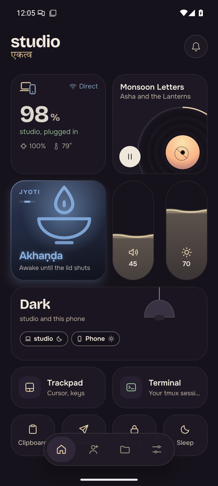
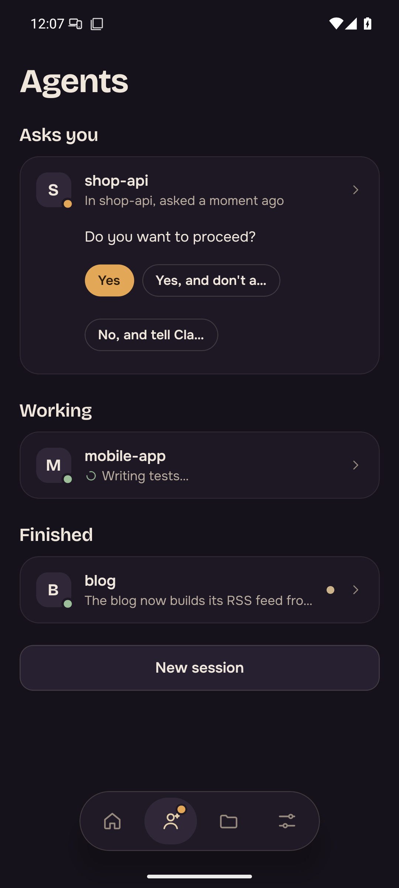
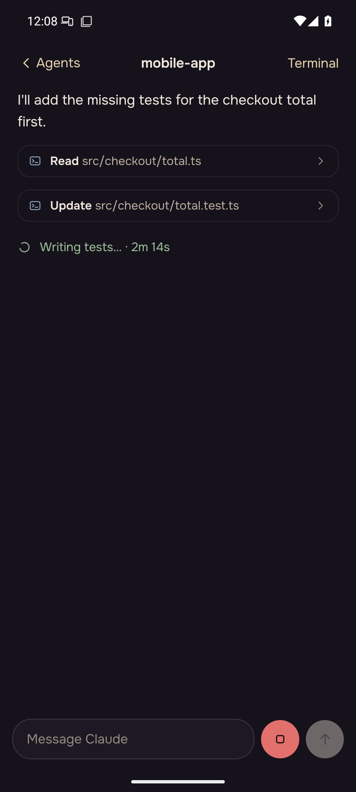
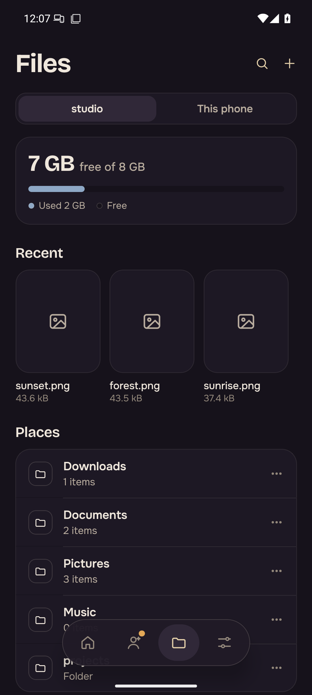
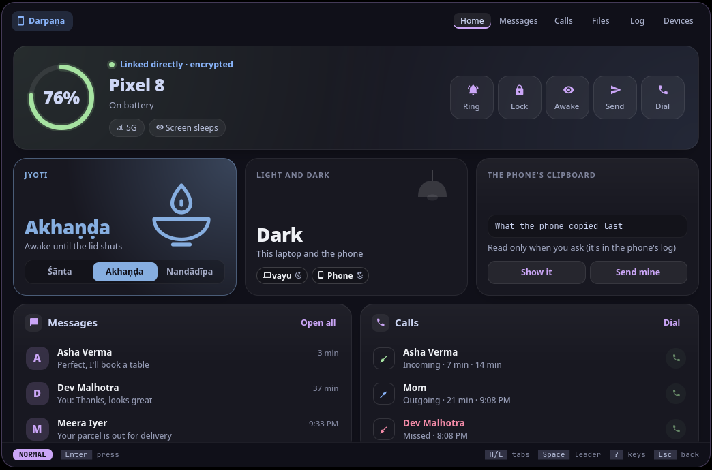
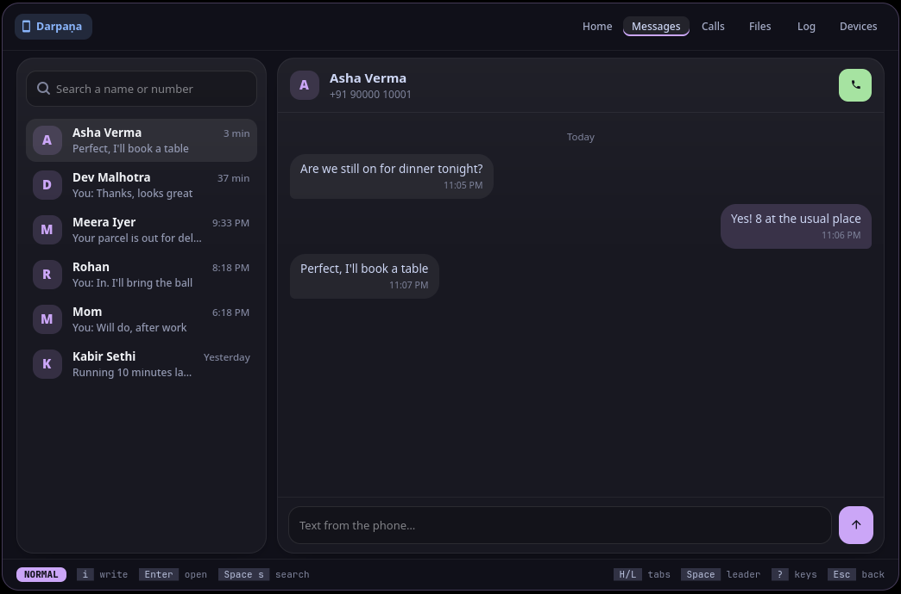
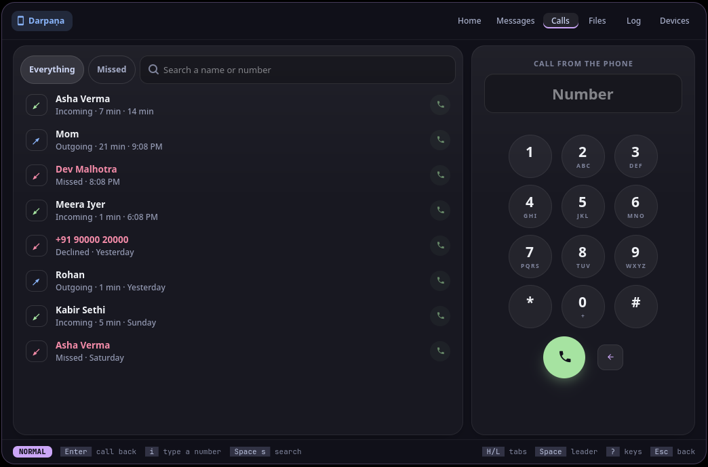
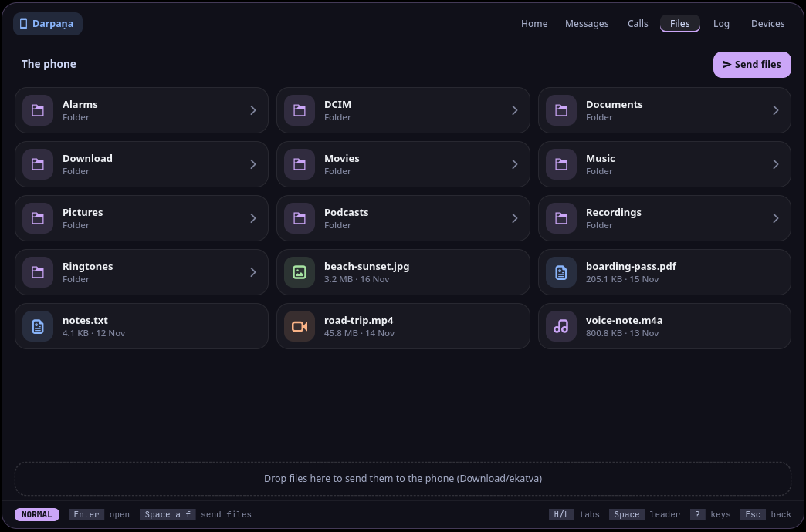

import { Card, CardGrid, LinkCard } from "@astrojs/starlight/components";

एकत्व · ekatva · "oneness"

<CardGrid stagger>
  <Card title="Agents in your pocket" icon="rocket">
    Claude Code is asking to run `pnpm test`? Your phone shows the question with its real options; one tap answers it in the right tmux pane. Reply, interrupt, or start a new session in any project.
  </Card>
  <Card title="Calls and texts from the laptop" icon="phone">
    Dial from the laptop, see who's calling, read and answer messages, and get the phone's notifications on your desktop.
  </Card>
  <Card title="Every file, both ways" icon="document">
    Browse, open, edit, move and delete files on the laptop from the phone, and on the phone from the laptop. Nothing is destroyed: every change can be undone.
  </Card>
  <Card title="Jyoti, even with the lid closed" icon="moon">
    Keep the laptop awake from the phone, even with the lid closed, for a long agent run in a bag. It still locks, and it gives up before the battery dies.
  </Card>
  <Card title="Logged, verified, undoable" icon="list-format">
    Every action, on both devices, goes into a hash-chained log, mirrored on the other device. Change one entry and the chain breaks.
  </Card>
  <Card title="Encrypted end to end" icon="seti:lock">
    Noise, the handshake WireGuard uses. On your Wi-Fi or through a tunnel, the network sees only ciphertext. No passwords, just keys.
  </Card>
</CardGrid>

## On the phone

Your agents first: what each one is asking, with its real options, one tap from an answer; what each is doing, and what's done. Then the laptop at a glance (battery, what's playing, volume and brightness, Jyoti, light and dark) and its files.

## On the laptop: Darpaṇa

The laptop's window is [Darpaṇa](https://theyashsawarkar.github.io/darpana/) (दर्पण, the mirror), a Vyom popup on `Super+o`: the phone at a glance, Jyoti, messages and calls with search, and the phone's files both ways. Incoming calls ring on the laptop's own notifications, with Answer and Reject, even with the phone in another room.

Screenshots use a made-up laptop, phone, people and projects (<code>apps/mobile/scripts/demo/shoot.sh</code>).

## How it fits together

{`  Laptop                                     Phone
  ekatva daemon (Node, systemd)              ekatva app (React Native)
    tRPC server + client  ◀── Noise ──▶  tRPC client + server
    agents · files · jyoti                    calls · SMS · notifications
    the action log + phone's mirror            its log + laptop's mirror
  Darpaṇa · waybar · \`ekatva\` CLI              fingerprint (keystore)`}

<CardGrid>
  <LinkCard title="Pair your phone" href="/ekatva/start/pairing/" description="One QR code, four emoji, done." />
  <LinkCard title="The action log" href="/ekatva/features/action-log/" description="What's recorded, where, and how undo works." />
  <LinkCard title="Add a feature" href="/ekatva/guides/capabilities/" description="Every feature is a capability: one contract, two sides." />
  <LinkCard title="Replacing KDE Connect" href="/ekatva/guides/kde-connect/" description="What it covers, and the plan to retire it in Vayu." />
</CardGrid>
